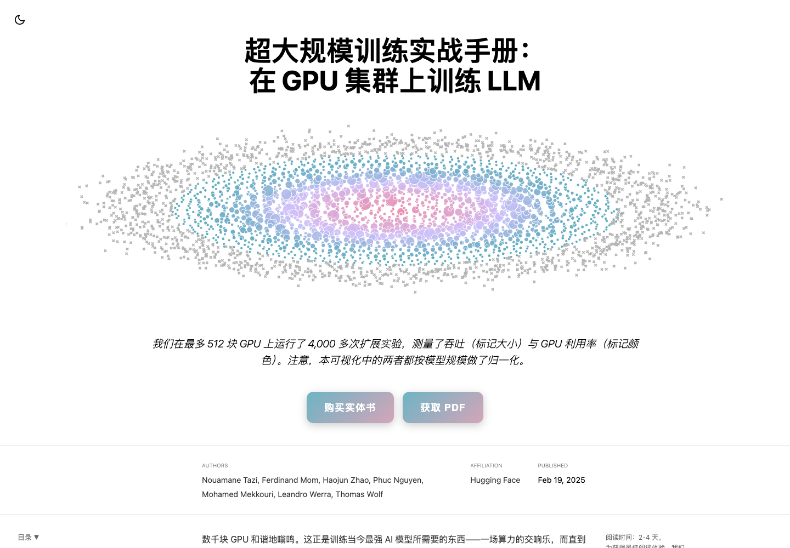

# 超大规模训练实战手册（中文翻译版）

> **The Ultra-Scale Playbook: Training LLMs on GPU Clusters** 的简体中文翻译版
>
> 从一块 GPU 到数千块 GPU：系统讲解大语言模型分布式训练的显存、计算与通信。



- 原文：[Hugging Face Spaces · nanotron/ultrascale-playbook](https://huggingface.co/spaces/nanotron/ultrascale-playbook)
- 在线阅读：[leonyuhe.github.io/ultrascale-playbook_zh](https://leonyuhe.github.io/ultrascale-playbook_zh/)
- 作者：Nouamane Tazi、Ferdinand Mom、Haojun Zhao、Phuc Nguyen、Mohamed Mekkouri、Leandro Werra、Thomas Wolf
- 中文翻译维护：[leonyuhe](https://github.com/leonyuhe)

## 关于这本书

这是一本关于在 GPU 集群上训练大语言模型的实战手册。作者在最多 512 块 GPU 上运行了 4,000 多次扩展实验，用理论、可运行代码和可复现基准，逐层拆解分布式训练的三大瓶颈：

- **显存**：参数、梯度、优化器状态与激活如何吃掉显存，以及重计算、混合精度、ZeRO 如何把它省回来。
- **计算效率**：数据并行、张量并行、序列并行、上下文并行、流水线并行、专家并行，以及 5D 并行的组合。
- **通信开销**：节点内与节点间带宽、集合通信、通信与计算重叠、流水线气泡与 Zero Bubble / DualPipe。

书中还包含 GPU 内核、融合算子、FlashAttention、混合精度和性能分析等底层内容，最后给出一套在真实集群上寻找最优训练配置的方法。

## 翻译说明

- 正文、章节标题、表格和图注已翻译为简体中文。
- 代码、命令行参数、变量名、URL、模型名、论文名、数字与公式保持原文。
- 交互式图表由原站脚本渲染，**图内标签**保留英文原文；正文对每张图的解释均已翻译。
- 本译文为社区翻译，**非 Hugging Face 官方中文版**。如发现术语或表述问题，欢迎提交 Issue / PR。

## 本地运行

需要 Node.js 20+。

```bash
npm install
npm run dev          # 本地开发
```

构建静态站点：

```bash
npm run build        # 输出到 dist/
```

## 部署到 GitHub Pages

在线站点：<https://leonyuhe.github.io/ultrascale-playbook_zh/>

仓库中的 `docs/` 是构建好的静态站点，`gh-pages` 分支与它保持同步，GitHub Pages 从该分支发布。

重新构建并发布：

```bash
npm run build:gh
git add docs
git commit -m "rebuild site"
git subtree push --prefix docs origin gh-pages
```

## 目录结构

```text
.
├── src/                 # 站点源码（index.html、样式、交互脚本）
│   └── fragments/       # 交互图表与小组件
├── assets/              # 图片、音频与实验数据
├── docs/                # 构建产物，GitHub Pages 站点
├── tools/               # 分块、校验、回填与路径修正脚本
├── LICENSE              # Apache 2.0
└── NOTICE               # 原文署名与翻译说明
```

## 许可与署名

原文由 Hugging Face 与原作者以 [Apache License 2.0](https://www.apache.org/licenses/LICENSE-2.0) 发布。本译文沿用同一许可，转载请注明原文与译者，并链接到本仓库。

详见 [LICENSE](LICENSE) 与 [NOTICE](NOTICE)。

## 致谢

感谢 Nouamane Tazi、Ferdinand Mom、Haojun Zhao、Phuc Nguyen、Mohamed Mekkouri、Leandro Werra、Thomas Wolf 写下这本手册并开放全部图表与实验数据；感谢 Hugging Face 与 Nanotron 团队。
